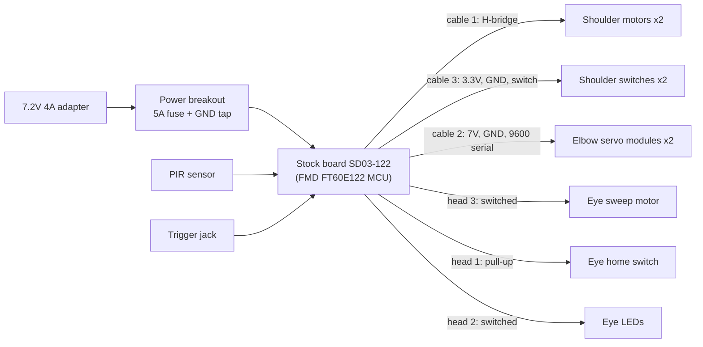

# Freddy Animatronic: custom controller

Reverse-engineering the control board of a Spirit Halloween Freddy Fazbear animatronic, so it can be replaced with an ESP32-S3 that runs custom reactions (and later, sound and AI).

**Status (November 2026):** Phase 1 (listen and decode) is complete. Every motor, sensor and protocol is understood, and the ESP32 already drives both elbows directly. Phase 2 (a custom, drop-in controller board) is under way: the [rev A PCB draft](docs/phase2-pcb.md) (with a speaker amp) is done, modules are ordered, and two bench tests are ready to run: the [power test](docs/phase2-power-test.md) and the [head test](docs/head-bench-test.md).

| Part | What it is | Status |
| --- | --- | --- |
| Shoulders | Reversing DC motor (~4 Ω) + one position switch | Decoded, both arms |
| Elbows | Smart serial servo module, 9600 baud, custom frames | Decoded **and controlled** by the ESP32 |
| Eyes | Sweep motor (cam), home switch, LEDs | Decoded; LED and motor currents measured |
| Trigger | 3.5mm jack, contact closure | Confirmed |
| PIR motion sensor | 3-wire sensor | Measured: yellow = ~7V power, orange = signal (~1.3V on motion) |

## System overview



In Phase 2 the stock board is removed and an ESP32-S3 controller plugs into the same connectors.

## Repository layout

| Path | Contents |
| --- | --- |
| [docs/hardware-map.md](docs/hardware-map.md) | Every cable and wire, with its role and measured voltages |
| [docs/arms.md](docs/arms.md) | Shoulder drive, shoulder switch, elbow overview, measured ranges |
| [docs/elbow-protocol.md](docs/elbow-protocol.md) | The elbow serial protocol and checksum, and how it was cracked |
| [docs/head.md](docs/head.md) | Eye motor, home switch and LEDs |
| [docs/phase1-harness.md](docs/phase1-harness.md) | How the listening harness, tap boards and test rigs are built |
| [docs/tooling.md](docs/tooling.md) | Arduino IDE, picocom, PulseView/sigrok setup (Arch Linux and Windows) |
| [docs/troubleshooting.md](docs/troubleshooting.md) | Lessons learned the hard way |
| [docs/phase2-plan.md](docs/phase2-plan.md) | Requirements and parts for the custom controller |
| [docs/head-bench-test.md](docs/head-bench-test.md) | Head bench test: what else can the eyes do (speed, reverse, aim, glances, LED effects)? |
| [docs/phase2-power-test.md](docs/phase2-power-test.md) | Breadboard power test: does the 5V rail survive a shoulder lift? |
| [docs/phase2-pcb.md](docs/phase2-pcb.md) | Controller PCB rev A: schematics, GPIO map, connectors, power budget, open questions |
| [hardware/controller/](hardware/controller/) | Placement sketch, BOM, net list |
| [schematics/](schematics/) | SVG schematics, regenerated by `tools/make_schematics.py` (Phase 1) and `tools/make_controller_schematics.py` (controller) |
| [firmware/](firmware/) | ESP32-S3 Arduino sketches (loggers, sniffer, elbow controllers) |
| [tools/](tools/) | `elbow_frame.py` (build and check frames), schematic generator |
| [captures/](captures/) | Raw logs from the stock board, used for the analysis |

## Quick start: move an elbow

1. Build the elbow replay rig ([docs/phase1-harness.md](docs/phase1-harness.md#elbow-replay-rig)), with the stock board disconnected.
2. Flash [`firmware/freddy_elbow_controller`](firmware/freddy_elbow_controller/) to an ESP32-S3.
3. `picocom -b 115200 /dev/ttyACM0`, press `h` to home, then use the arrow keys to jog.

Or build any frame by hand:

```bash
python3 tools/elbow_frame.py build -400 1500
# AB 01 09 41 70 FE DC 05 45
```

## Safety notes

- Every ESP32 input goes through a 47k/22k divider (7.6V becomes 2.4V) or a 1kΩ series resistor. Nothing on the harness is wired straight to a GPIO.
- **Always tie the ESP32's ground to Freddy's ground.** A missing ground caused most of the confusing readings during Phase 1.
- Elbow commands are clamped to the measured ranges (right −700..350, left −700..550).
