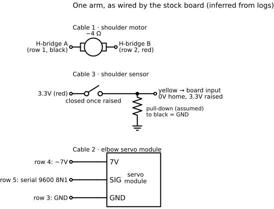
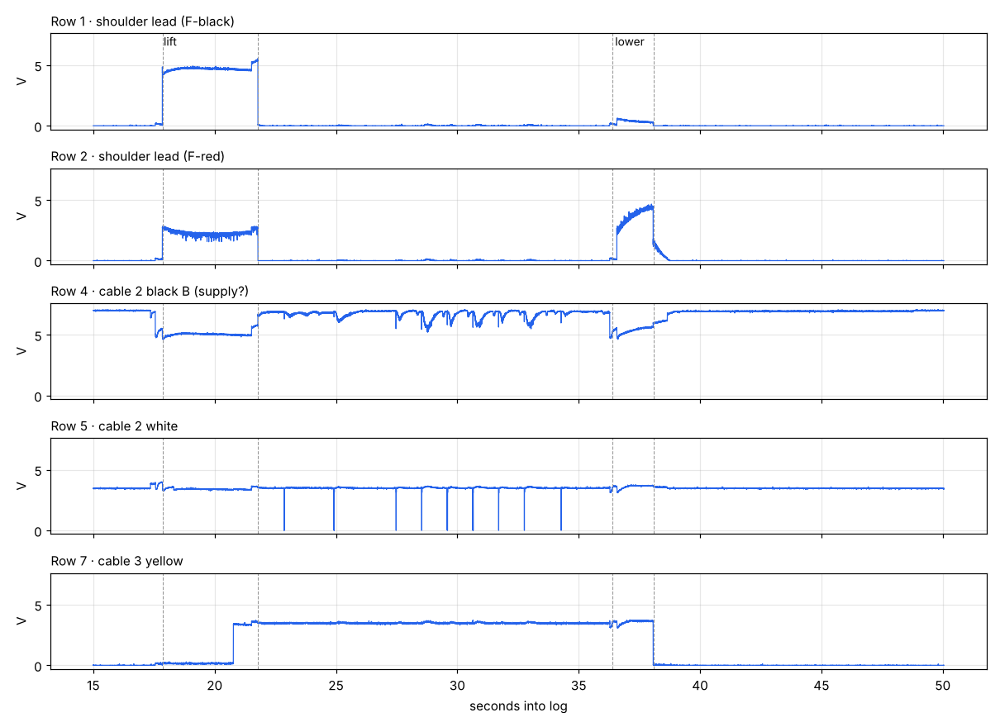
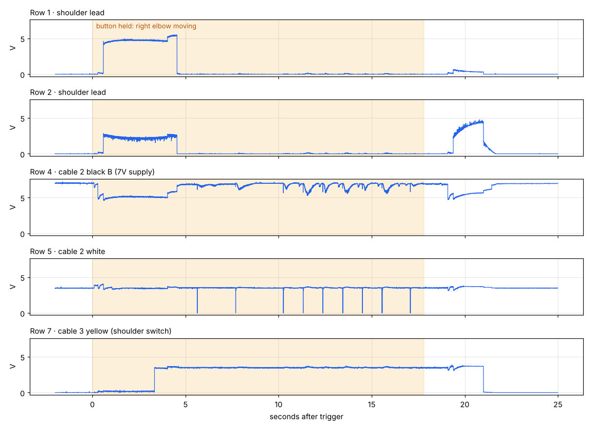

# Arms

Each arm has a shoulder (plain DC motor plus a switch) and an elbow (a smart serial servo). Both arms are wired identically.

## Shoulder motor (cable 1)

- Winding resistance ~4 Ω (worst-case stall ~1.8A at 7.2V).
- Reversing H-bridge. Both arms use the same polarity:

| Move | Row 1 (black) | Row 2 (red) | Duration (stock) |
| --- | --- | --- | --- |
| Lift | ~4.4–5.5V | ~2.6V | about 4 s |
| Lower | ~0.3–0.5V | ~4.2V | about 2 s |

- The stock lift puts only about **3V across the motor** (row 2 is held around 2.6V, not 0V), so it lifts slowly and sounds labored. That's intentional. Lowering gets full drive.
- The gearbox doesn't back-drive, so the arm holds its position with power off.

## Shoulder switch (cable 3)

| Wire | Reading | Role |
| --- | --- | --- |
| Red | steady 3.45V | Sensor supply (the board's 3.3V rail) |
| Black | 0V | Ground |
| Yellow | 0V at home; 3.45V once raised | Position switch |
| White | always 0V | Unknown (unused, or a limit never reached) |

**Stock logic:** lift until yellow goes high, keep driving about 1.2 s more, hold, then lower until yellow goes low. After a power cut the arm re-homes.

The shoulder has **no continuous position feedback**. Custom firmware can do timed lifts with re-homing, using the switch as a landmark. For true angle control, add a tilt sensor (MPU6050) on the upper arm. See [phase2-plan.md](phase2-plan.md).

## Elbow (cable 2)

The elbow is a self-contained servo module: power, ground and a one-way 9600-baud serial line. Full details are in [elbow-protocol.md](elbow-protocol.md).

| Elbow | Device ID | Range | Home | Stock board used |
| --- | --- | --- | --- | --- |
| Right | 01 | −700 to 350 (servo stops near −675) | −700 | −700 to 200 |
| Left | 01 | −700 to 550 | −700 | not captured |

Both elbows answer to ID 01. The board tells them apart by **which wire** it talks on, so a controller needs one transmit pin per elbow.

Ranges were found with `freddy_left_test` (`x` command): it steps outward from 0 and watches the 7.6V rail for the dip a moving motor causes, stopping when two steps in a row get no response. On the left arm there's a large current spike near 500, which may be the arm meeting a physical stop. Treat the top end with care.

The shaded band marks a button held while the elbow moved. No motor drive appears on any wire, only the serial line activity on row 5, which is how the serial module was discovered.
