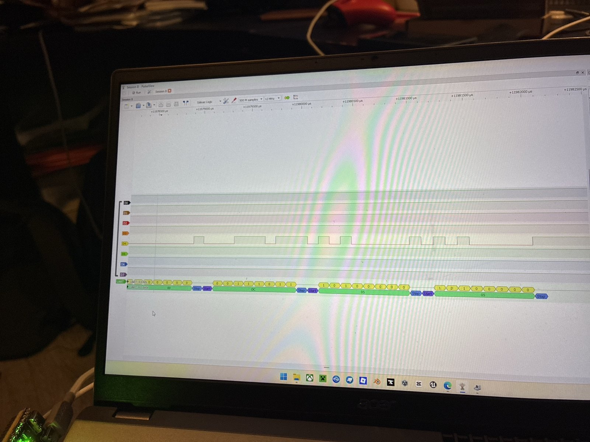
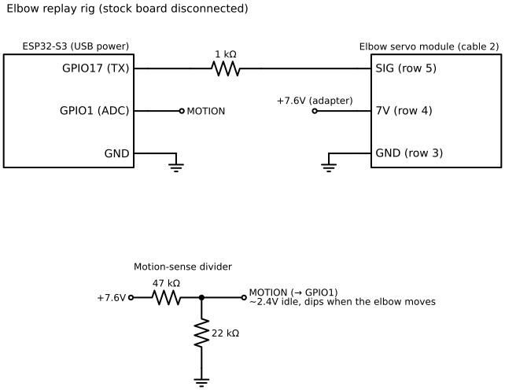

# Elbow protocol

Each elbow is a serial servo module, commanded one-way over its arm's cable 2 signal wire (tap row 5).

## Link

- **9600 baud, 8N1, idle high** (3.45–3.6V)
- One-way: no replies were ever seen
- Each elbow has its own wire, and **both use device ID 01**



## Frame

Nine bytes, multi-byte fields little-endian:

| Byte | Example | Meaning |
| --- | --- | --- |
| 0 | `AB` | Start of frame |
| 1 | `01` | Device ID |
| 2 | `09` | Frame length |
| 3 | `41` | Command: move |
| 4–5 | `06 FF` | Target position, signed 16-bit (−250) |
| 6–7 | `DC 05` | Move time in ms (1500) |
| 8 | `37` | Checksum |

## Checksum

```
checksum = (0xAF + 9·b0 + 8·b1 + 7·b2 + 6·b3 + 5·b4 + 4·b5 + 3·b6 + 2·b7) & 0xFF
```

This is a weighted byte sum, equivalent to a Fletcher-style running sum over the frame with the checksum slot zeroed. It matches all 19 known frames and was confirmed on a frame nobody had captured (`−400`, which moved on the first try). `python3 tools/elbow_frame.py test` checks it against every known frame.

## Behavior

- One frame starts a move. The stock board resends the active command about every **1.06 s** as a keep-alive.
- A frame for the current position causes no movement (the captured "hold" frame).
- A frame with a wrong checksum is ignored.
- The module rests at home and draws holding current anywhere else. That current shows up as a dip on the 7.6V rail, which `freddy_elbow_controller` and `freddy_left_test` use as a motion detector (moves from home dip 0.46–0.80V; ignored frames ~0V).

## Captured stock frames (right elbow)

| Frame | Meaning |
| --- | --- |
| `AB 01 09 41 C8 00 E8 03 25` | Go to 200 in 1000 ms (elbow in) |
| `AB 01 09 41 C8 00 DC 05 05` | Go to 200 in 1500 ms (hold, sent repeatedly) |
| `AB 01 09 41 44 FD DC 05 65` | Go to −700 in 1500 ms (home) |

Full capture: [captures/right_elbow_uart_9600.txt](../captures/right_elbow_uart_9600.txt).

## How it was cracked

1. **Unplug tests** showed cable 2 affected the elbow, but no motor drive ever appeared on its wires.
2. **The logic analyzer** on row 5 showed ~10 ms bursts of varying-width pulses: serial data, not a switch. PulseView's UART decoder at 9600 baud gave clean bytes.
3. **Replaying** the captured frames from the ESP32 moved the elbow. A frame with a wrong checksum didn't, so the checksum is enforced.
4. **The checksum hunt:** the ESP32 tried all 256 checksum values on new frames. At first a person watched for movement; then the motion-sense divider detected moves automatically. Sixteen frames, each differing from a known one by a single bit, were solved in 38 minutes unattended.
5. **The single-bit differences** showed the checksum changing by exactly 5 per unit of position and 3 per unit of time. That's arithmetic, not a CRC, and it led directly to the formula.


