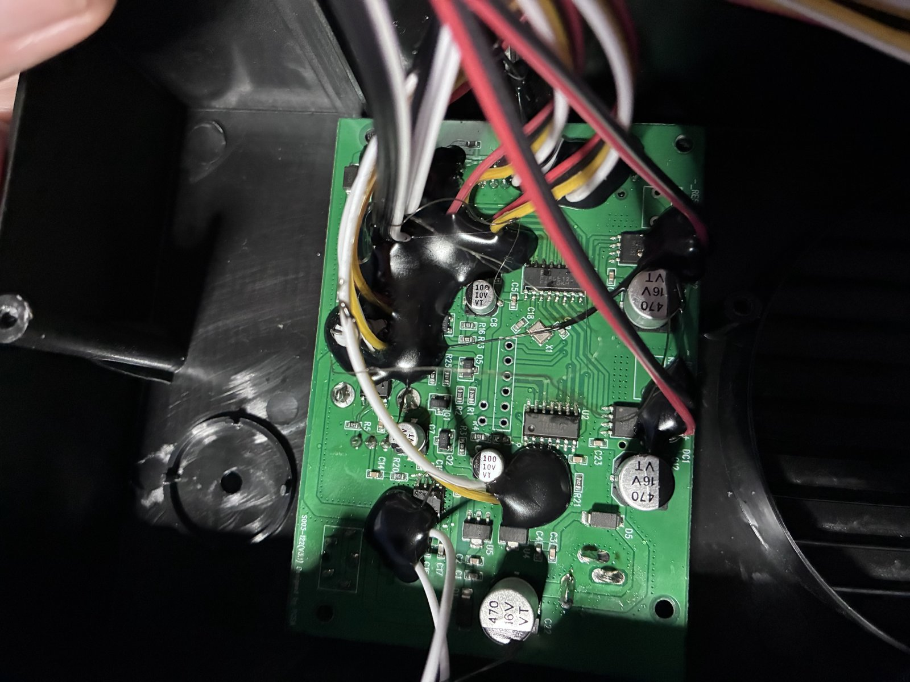

# Hardware map

Everything plugs into the stock board with SM-style connectors (2.54mm pitch). Voltages are real values (undivided), measured against Freddy's ground with the stock board running.

## Stock board

- Silkscreen: **SD03-122 (V3.1) Designed by PCEA**. There's no public schematic.
- Main MCU: **Fremont Micro Devices FT60E122** (8-bit, probably one-time programmable). The other chips are glob-top epoxy.
- Supply: 7.2V 4A wall adapter, 5.5×2.1mm barrel, center-positive. It reads 7.6V unloaded and sags to about 4.9V while a shoulder lifts.

## Cables

| Cable | Pins | Freddy's wire colors | Role | Notes |
| --- | --- | --- | --- | --- |
| Arm cable 1 | 2 | black, red | Shoulder motor | ~4 Ω, reversing H-bridge. Same on both arms |
| Arm cable 2 | 3 | right: white, black, black · left: black, white, white | Elbow servo module | Tap rows: 3 = GND, 4 = ~7V, 5 = serial signal. Same pin positions on both arms despite the colors |
| Arm cable 3 | 4 | red, black, yellow, white | Shoulder sensor | Red 3.3V, black GND, yellow position switch, white unknown (always 0V) |
| Head cable 1 | 2 | yellow, white | Eye home switch | Yellow pulled up to 4.8V, white GND |
| Head cable 2 | 2 | yellow, white | Eye LEDs | Switched on/off by the board; off at idle |
| Head cable 3 | 2 | yellow, orange | Eye sweep motor | Yellow ~7V, orange switched to ground |
| PIR | 3 | orange, yellow, black | Motion sensor | Measured: **yellow = power (~7V, raw supply)**, **orange = signal** (0V idle, ~1.3V on motion), black = GND |
| Trigger | 3.5mm mono | tip, sleeve | Start button | Contact closure starts a show |

## Tap board row map (arm)

| Row | Cable | Freddy wire | Hot pin |
| --- | --- | --- | --- |
| 1 | Cable 1 | black | |
| 2 | Cable 1 | red | |
| 3 | Cable 2 | black A (right) / ground | |
| 4 | Cable 2 | black B (right) / ~7V | |
| 5 | Cable 2 | white (right) / signal | yes |
| 6 | Cable 3 | red | |
| 7 | Cable 3 | yellow | yes |
| 8 | Cable 3 | white | yes |
| 9 | Cable 3 | black | |
| 10 | Power breakout | + (7.6V) | |

The pigtail colors on the breakouts don't match Freddy's colors, so the breakouts are labeled with Freddy's colors.

## The stock show (one cycle, about 30 s)

| Time after trigger | Shoulders | Elbows | Eyes |
| --- | --- | --- | --- |
| 0–4 s | Lift (gentle ~3V drive) until the switch trips, plus ~1.2 s | | Motor starts, sweeping |
| 4–18 s | Holding up | Right elbow: in to 200, held with keep-alive frames | Sweeping, ~4.4 s per sweep |
| ~18–20 s | Lower (full drive) until the switch reads home | Home (−700) | |
| End | | | LEDs flicker, then the motor stops on the home switch |

See [arms.md](arms.md) and [head.md](head.md) for the evidence and logs.
