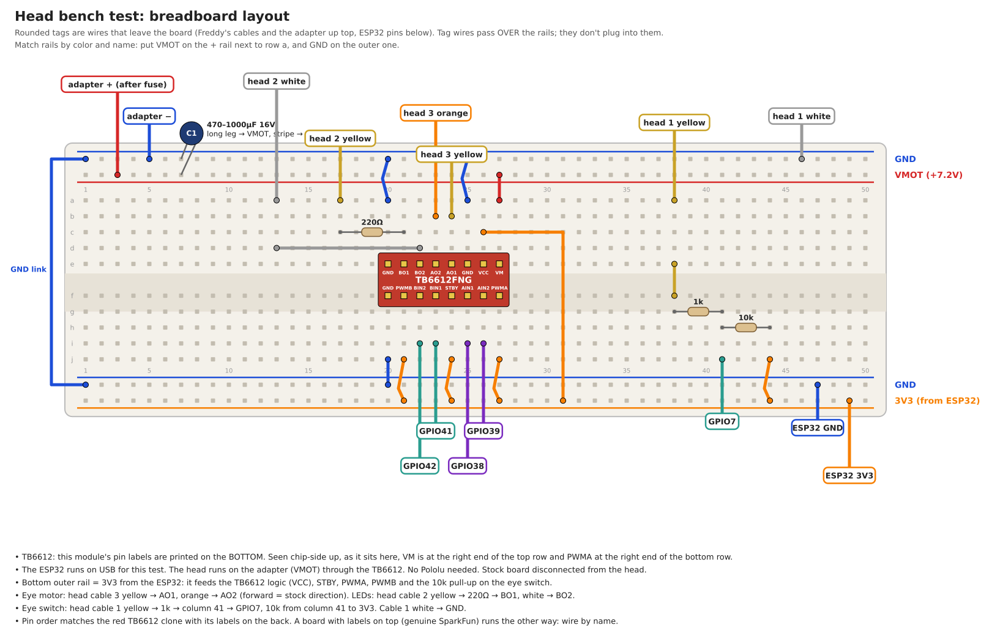

# Head bench test

The stock board uses the head in exactly one way: eye motor forward at full power for the whole show, stop on the home switch, LEDs on or flickering. This test drives the head from a **TB6612** (the same driver the controller board uses) to find out what else it can do.

**Questions to answer:**

1. **Speed:** what's the slowest speed that still turns the cam, and how does sweep time change with speed?
2. **Reverse:** does the eye motor run backwards? The stock board never tried.
3. **Aim:** can we stop the eyes at a chosen point (look left, look right) by timing from the home switch, and how repeatable is it?
4. **Glances:** do short forward/back pulses make convincing eye darts?
5. **LEDs:** how dim can they go and still be visible, and do breathing and flicker look good?

## Parts

- ESP32-S3 (powered from USB), one TB6612 module
- Freddy's adapter through the Phase 1 power breakout (5A fuse)
- 220Ω (LEDs), 1k and 10k (eye switch), a 470–1000µF capacitor
- **Stock board disconnected from the head**

## Wiring



| From | To |
| --- | --- |
| Adapter + (after the fuse) / adapter − | VMOT rail / GND rail |
| TB6612 VM | VMOT |
| TB6612 VCC, STBY, PWMA, PWMB | 3V3 (the ESP32's 3V3 pin, on the bottom outer rail) |
| TB6612 GND pins | GND |
| TB6612 AIN1 / AIN2 | GPIO38 / GPIO39 |
| TB6612 BIN1 / BIN2 | GPIO41 / GPIO42 |
| TB6612 AO1 / AO2 | head cable 3 **yellow** / **orange** (eye motor) |
| TB6612 BO1 → 220Ω → head cable 2 **yellow**; BO2 → cable 2 **white** | eye LEDs |
| Head cable 1 **yellow** → 1k → GPIO7, plus 10k from GPIO7 to 3V3; cable 1 **white** → GND | eye home switch |
| ESP32 GND | GND rail |

These are breadboard pins. The controller PCB drives the eyes from GPIO11/12 (motor) and GPIO15/16 (LEDs) instead (see [`firmware/freddy_pcb_pins.h`](../firmware/freddy_pcb_pins.h)), so change the four pin numbers at the top of the sketch when moving to the board.

## Web dashboard (recommended)

Flash [`firmware/freddy_head_web`](../firmware/freddy_head_web/) (needs the "ESP Async WebServer" and "Async TCP" libraries by ESP32Async; copy `secrets.h.example` to `secrets.h` for your WiFi) and open **http://freddy.local**. Without `secrets.h` it starts an access point "Freddy" (password `fazbear1987`) at http://192.168.4.1. The header shows the firmware version.

**The eye home switch is broken.** Its two leaf contacts came out of their holder during testing (probably while running the cam in reverse, which the stock board never does), and they can't be reached without taking the eye mechanism apart. Since v1.2.0 the sketch positions the eyes by time alone, with center set by eye. **v2.0.0 adds a calibration wizard** at the top of the page that walks through the steps below (center, turn length, full right, full left, then a check tour of center → right → left → center), with Back, Skip and Cancel (Cancel puts the old calibration back). **Quick re-center** is just the first step, for when the eyes have drifted. The manual controls are still there under "Manual calibration". The steps:

1. **Find center:** jog with 20–250 ms pulses until the eyes look dead ahead, then **Set center here**.
2. **Learn the turn length:** **Spin 10 turns**, jog back to dead center if they're off, then **Back at center: learn turn**. It divides the whole trip by the number of turns, so jog error barely counts. (Defaults: 4224 ms per turn, full right at 33% and full left at 70% of a turn, measured on the bench head. A board with nothing saved assumes the eyes start centered.)
3. **Mark full right / full left:** jog to each extreme and mark it. **Go to** center, right, left or any % of a turn is then a timed forward move.
4. If go-to moves land a little past the target, raise the **aim lead**.

Position is the time travelled forward at full speed since center. It's saved in flash when the eyes stop, so it survives a reboot (the gearbox shouldn't move with the power off). Every start and stop adds a few ms of error, so re-center by eye now and then. Free running below 100% stops position tracking.

Also on the page: dart, LED modes (off / on / breathe / flicker / blink, perceptual brightness, period), LED steps, a results table and the log (both kept on the ESP32, so a reload keeps them).

For the controller and rev B: a Hall sensor and a magnet on the cam would replace the leaf switch with nothing to bend, wired to the same eye-switch input.

## Run it (serial only)

Flash [`firmware/freddy_head_test`](../firmware/freddy_head_test/), then:

```bash
picocom -b 115200 --imap lfcrlf /dev/ttyACM0
```

Type a command and press Enter. **`x` or space stops the motor instantly**, no Enter needed. The sketch prints every home-switch closure with the time since the last one.

| Command | Does |
| --- | --- |
| `f` / `r` | Run forward (stock direction) / reverse at the current speed |
| `speed 40` | Motor speed in % |
| `home` | Run forward until the switch closes (eyes straight ahead), then brake |
| `measure` | Time 3 sweeps at the current speed (needed for `goto`) |
| `goto 25` | Home, then run 25% of a sweep further and stop |
| `nudge 150` | 150 ms forward pulse (`nudge -150` for reverse) |
| `dart` | Glance demo: short pulses either side of center (run `home` first) |
| `led 30` | LED brightness in % (`led 0` = off) |
| `breathe` / `flicker` | LED effects at the current brightness |
| `status` | Current settings |

## Experiments

1. **Basics:** `led 100`, then `led 0`. Then `home`: the eyes should end up straight ahead.
2. **Speed range:** `speed 100`, `measure`. Repeat at 80, 60, 40, 30, 20… until the cam stalls (`f` and watch). Note sweep time per speed. Stock is about 4.4 s at full power.
3. **Reverse:** `speed 60`, `r`. Does the cam turn backwards smoothly? Do the switch closures still happen?
4. **Aim:** at one speed, `measure`, then `goto 25` and `goto 75`. Are those the two extremes (left and right)? Repeat each 3–4 times: how close does it land each time?
5. **Glances:** `home`, then try `nudge 150`, `nudge -150`, and `dart`. Try different speeds and pulse lengths.
6. **LEDs:** step `led` down from 100 to find where they stop being visible. Try `breathe` and `flicker`.

Write the results into this doc (a table of speed vs sweep time, and notes per experiment). They decide which eye behaviors the final firmware offers.

## Notes

- The TB6612 brakes the motor (shorts it) on stop, so it stops faster than the stock board's coast. Expect less overshoot than stock.
- The motor only draws ~90mA, so the adapter never sags in this test, and the ESP32 is fine on USB.
- If `home` times out, check cable 1 and the 10k pull-up, or the speed is too low to turn the cam.
