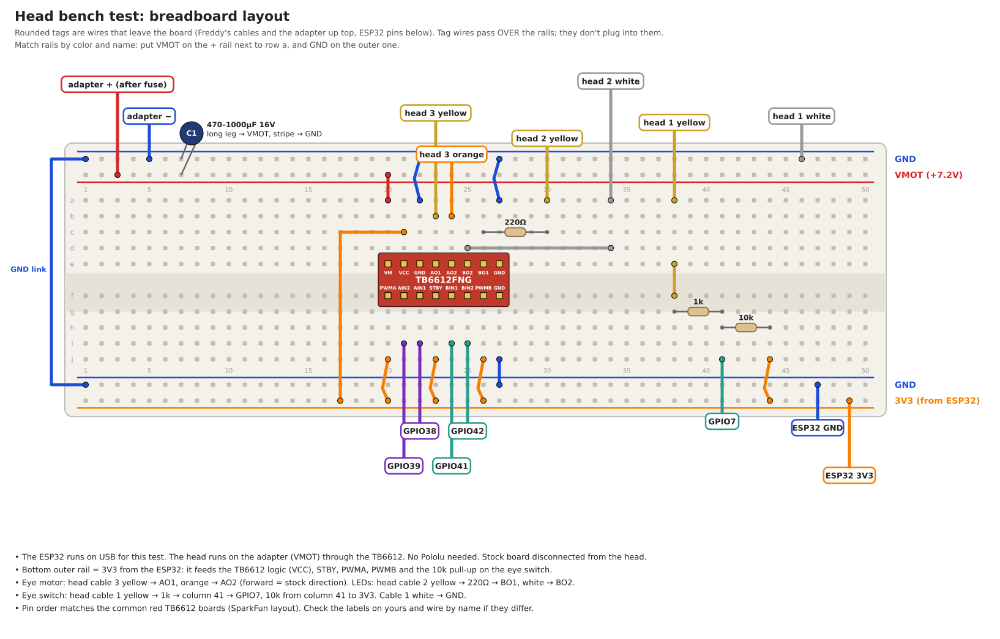

# Head bench test

The stock board uses the head in exactly one way: eye motor forward at full power for the whole show, stop on the home switch, LEDs on or flickering. This test drives the head from a **TB6612** (the same driver the controller board uses) to find out what else it can do.

**Questions to answer:**

1. **Speed:** what's the slowest speed that still turns the cam, and how does sweep time change with speed?
2. **Reverse:** does the eye motor run backwards? The stock board never tried.
3. **Aim:** can we stop the eyes at a chosen point (look left, look right) by timing from the home switch, and how repeatable is it?
4. **Glances:** do short forward/back pulses make convincing eye darts?
5. **LEDs:** how dim can they go and still be visible, and do breathing and flicker look good?

## Parts

- ESP32-S3 (powered from USB), one TB6612 module
- Freddy's adapter through the Phase 1 power breakout (5A fuse)
- 220Ω (LEDs), 1k and 10k (eye switch), a 470–1000µF capacitor
- **Stock board disconnected from the head**

## Wiring



| From | To |
| --- | --- |
| Adapter + (after the fuse) / adapter − | VMOT rail / GND rail |
| TB6612 VM | VMOT |
| TB6612 VCC, STBY, PWMA, PWMB | 3V3 (the ESP32's 3V3 pin, on the bottom outer rail) |
| TB6612 GND pins | GND |
| TB6612 AIN1 / AIN2 | GPIO38 / GPIO39 |
| TB6612 BIN1 / BIN2 | GPIO41 / GPIO42 |
| TB6612 AO1 / AO2 | head cable 3 **yellow** / **orange** (eye motor) |
| TB6612 BO1 → 220Ω → head cable 2 **yellow**; BO2 → cable 2 **white** | eye LEDs |
| Head cable 1 **yellow** → 1k → GPIO7, plus 10k from GPIO7 to 3V3; cable 1 **white** → GND | eye home switch |
| ESP32 GND | GND rail |

These are the same pins the controller board uses, so the firmware carries straight over.

## Run it

Flash [`firmware/freddy_head_test`](../firmware/freddy_head_test/), then:

```bash
picocom -b 115200 --imap lfcrlf /dev/ttyACM0
```

Type a command and press Enter. **`x` or space stops the motor instantly**, no Enter needed. The sketch prints every home-switch closure with the time since the last one.

| Command | Does |
| --- | --- |
| `f` / `r` | Run forward (stock direction) / reverse at the current speed |
| `speed 40` | Motor speed in % |
| `home` | Run forward until the switch closes (eyes straight ahead), then brake |
| `measure` | Time 3 sweeps at the current speed (needed for `goto`) |
| `goto 25` | Home, then run 25% of a sweep further and stop |
| `nudge 150` | 150 ms forward pulse (`nudge -150` for reverse) |
| `dart` | Glance demo: short pulses either side of center (run `home` first) |
| `led 30` | LED brightness in % (`led 0` = off) |
| `breathe` / `flicker` | LED effects at the current brightness |
| `status` | Current settings |

## Experiments

1. **Basics:** `led 100`, then `led 0`. Then `home`: the eyes should end up straight ahead.
2. **Speed range:** `speed 100`, `measure`. Repeat at 80, 60, 40, 30, 20… until the cam stalls (`f` and watch). Note sweep time per speed. Stock is about 4.4 s at full power.
3. **Reverse:** `speed 60`, `r`. Does the cam turn backwards smoothly? Do the switch closures still happen?
4. **Aim:** at one speed, `measure`, then `goto 25` and `goto 75`. Are those the two extremes (left and right)? Repeat each 3–4 times: how close does it land each time?
5. **Glances:** `home`, then try `nudge 150`, `nudge -150`, and `dart`. Try different speeds and pulse lengths.
6. **LEDs:** step `led` down from 100 to find where they stop being visible. Try `breathe` and `flicker`.

Write the results into this doc (a table of speed vs sweep time, and notes per experiment). They decide which eye behaviors the final firmware offers.

## Notes

- The TB6612 brakes the motor (shorts it) on stop, so it stops faster than the stock board's coast. Expect less overshoot than stock.
- The motor only draws ~90mA, so the adapter never sags in this test, and the ESP32 is fine on USB.
- If `home` times out, check cable 1 and the 10k pull-up, or the speed is too low to turn the cam.
