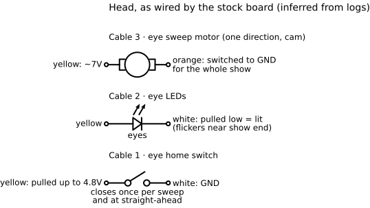
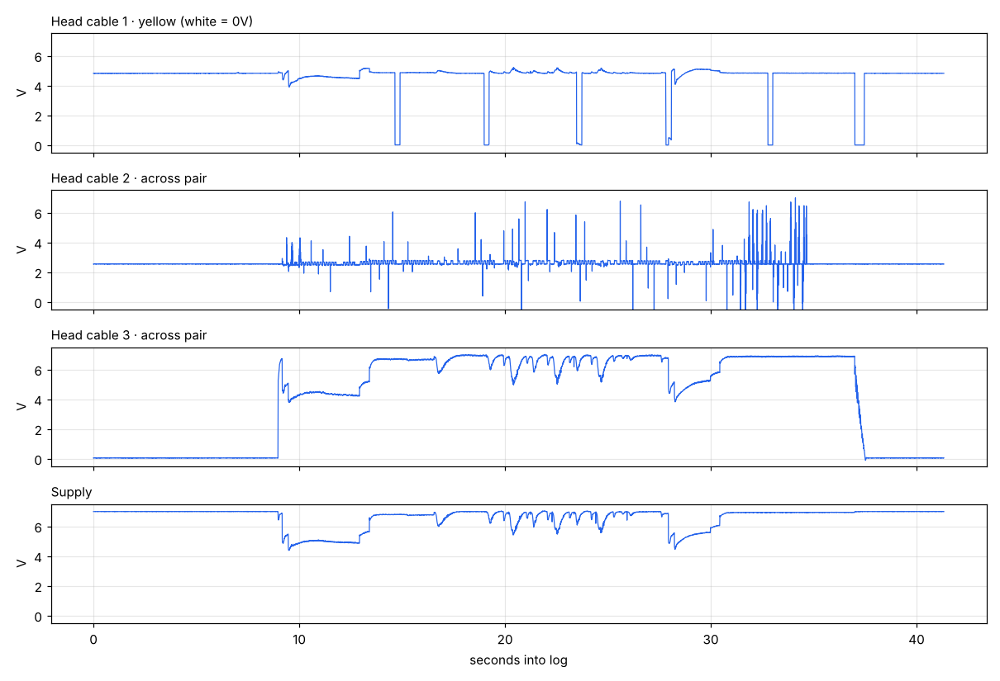

# Head

The head is a one-way eye motor, a home switch and a set of LEDs. There's no serial device and no position control beyond "run until home".

| Cable | Role | Behavior during a show |
| --- | --- | --- |
| 3 (yellow/orange) | Eye sweep motor | Switched on for the whole show, always one direction; a cam turns rotation into the side-to-side sweep. About 4.4 s per sweep, six sweeps |
| 1 (yellow/white) | Eye home switch | Yellow pulled up to 4.8V. Drops to 0V for ~250 ms once per sweep; the last drop (~460 ms) is when the board stops the motor |
| 2 (yellow/white) | Eye LEDs | Off at idle. Yellow = + (anode), white = − (cathode), one direction only; the board lights them by pulling white low. ~2.8V across when lit, ~20mA (meter reading, flicker averaged). Rapid flicker near the end of the show |

**Stock logic:** start the eye motor with the show, keep it running, and at the end stop it on the next home-switch closure so the eyes face straight ahead.

**Confirmed by unplug tests:**
- Cable 2 unplugged: the eyes don't light.
- Cable 1 unplugged: the eyes still sweep, but stop off-center.

**A misleading reading:** at idle, cable 2 shows about 2.55V across the pair. That's leakage through the LEDs into the logging divider, not the LEDs being driven.

Log: [captures/head_show.csv](../captures/head_show.csv) (from `freddy_head_monitor`).

## For Phase 2

See the [head bench test](head-bench-test.md) for exploring speed, reverse, aiming and LED effects.

- Eye motor: one low-side MOSFET (one direction is enough).
- Home switch: a GPIO with a pull-up; stop the motor on its falling edge.
- LEDs: one direction, ~2.8V at ~20mA. From a ~7V rail that needs a ~220Ω series resistor; PWM for dimming and flicker.

**Measured currents (stock show):** eye motor 80–90mA running; eye LEDs ~20mA. Both well inside a TB6612 channel (1.2A continuous).
