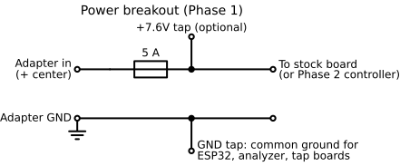
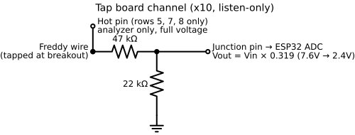
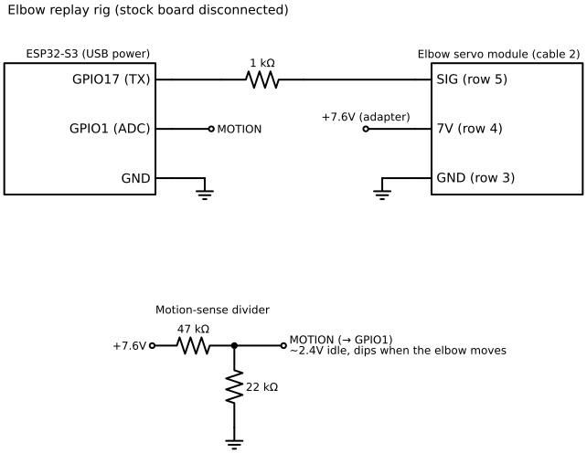
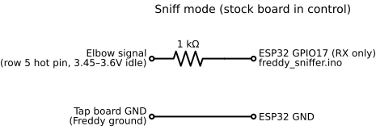

# Phase 1 harness and test rigs

Phase 1 is listen-first: the stock board keeps running Freddy while inline breakouts tap every wire. The ESP32 only listens, except in the elbow replay rig, where the stock board is disconnected.

## Power breakout

A female and a male 5.5×2.1mm screw-terminal barrel adapter, with a 5A fuse on the + side. It provides the **common ground** for everything else, plus an optional +7.6V tap.

Tests: + to + beeps, − to − beeps, + to − never beeps, and continuity drops when the fuse is pulled. Powered: ~7.6V, center positive.

## Cable breakouts

A matched SM pigtail pair per cable, spliced straight through, with a 24AWG tap wire added at each splice. Freddy plugs through them unchanged. Label the breakouts with Freddy's wire colors, since the pigtail colors differ.

## Tap board

Ten identical 47k/22k divider channels on perfboard. Junction pins go to the ESP32 ADC; hot pins (rows 5, 7, 8) are for the logic analyzer on lines confirmed at 5V or less.

- Ratio 22/(47+22) = 0.319, so 7.6V reads as 2.4V. The logger multiplies by 3.14 to get the real voltage back.
- The ~69k total keeps the load on Freddy's signals light.

Unpowered checks: input to ground ~69k, junction to ground ~22k, input to junction ~47k.

## Elbow replay rig

The ESP32 talks to an elbow directly, with the stock board **disconnected**. Breadboard: top − rail = GND, bottom + rail = 7.6V (taped), and a 1kΩ resistor from GPIO17 to the replay plug's signal lead.

- **Replay plug:** a spare SM 3-pin pigtail plugged into cable 2's breakout. Confirm with continuity which lead lands on row 3 (GND), row 4 (7V) and row 5 (signal).
- **Motion sense:** a second 47k/22k divider on the 7.6V rail into GPIO1. Calibrate it with the `c` command in the firmware.
- Power-up order: ESP32 on USB first, then the adapter.

## Sniff mode

To read what the stock board sends an elbow: the stock board stays connected, the signal row's hot pin goes through the 1kΩ to GPIO17 (as an input), and ESP32 GND is tied to Freddy's ground. Run only `freddy_sniffer` here, never the controller sketch, since it transmits.

## Head logging board

Six (plus one for the supply) 47k/22k dividers on a spare breadboard, reading the six head wires on GPIO1–6 and the supply on GPIO7. Each divider: 47k from the input column to the junction column, 22k from the junction straight into a − rail.

| Divider | Tap wire | ESP32 |
| --- | --- | --- |
| 1 | Head 1 yellow | GPIO1 |
| 2 | Head 1 white | GPIO2 |
| 3 | Head 2 yellow | GPIO3 |
| 4 | Head 2 white | GPIO4 |
| 5 | Head 3 yellow | GPIO5 |
| 6 | Head 3 orange | GPIO6 |
| 7 | Power breakout + | GPIO7 |

Before connecting the ESP32: every junction must read under 3.1V with Freddy running.

## Parts used

ESP32-S3 dev boards (×2), 8-channel 24MHz USB logic analyzer, SM 2/3/4-pin pigtail pairs, 5.5×2.1 screw-terminal barrel adapters, inline ATC fuse holders and 5A fuses, a resistor kit (47k, 22k, 1k), ELEGOO perfboard, 400-point breadboards, Dupont jumpers, tinned stranded 24AWG wire, heat shrink, 2.54mm header strips, an Etekcity multimeter and needle probes.
