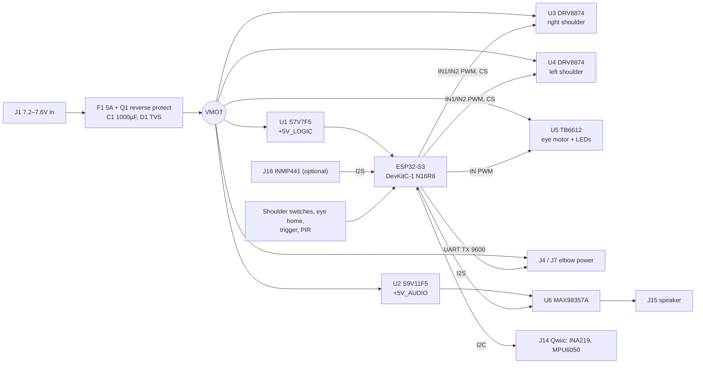

# Phase 2: controller PCB (rev A, first draft)

A carrier board that replaces the stock SD03-122. The ESP32-S3 and the power and driver parts are off-the-shelf modules on headers, so rev A is easy to hand-solder, debug and rework. A later revision can put the parts directly on the board once the design has proven itself.

**Status:** schematic draft and placement sketch. Not in KiCad yet. See [open questions](#open-questions) before ordering anything.

| Sheet | File |
| --- | --- |
| 1. Power | [controller_power.svg](../schematics/controller_power.svg) |
| 2. Motor drivers | [controller_motors.svg](../schematics/controller_motors.svg) |
| 3. Elbows, sensors, inputs | [controller_signals.svg](../schematics/controller_signals.svg) |
| 4. Audio | [controller_audio.svg](../schematics/controller_audio.svg) |
| 5. ESP32-S3 pin map | [controller_esp32.svg](../schematics/controller_esp32.svg) |
| Placement (to scale) | [placement.svg](../hardware/controller/placement.svg) |
| BOM | [bom.csv](../hardware/controller/bom.csv) |
| Net list | [netlist.csv](../hardware/controller/netlist.csv) |

All of these are generated by `tools/make_controller_schematics.py` (except the CSVs). The sheets use net labels: two pins with the same net name are connected.

## Block diagram

## Design choices

- **Modules, not bare chips (rev A).** Pololu carriers already have their bypass caps, current-sense resistors and thermal copper. Each one sits on 0.1" headers, so a dead driver is a 30-second swap.
- **Three rails.** VMOT is the raw adapter after the fuse. It drives the shoulders, eye motor and elbows directly, as the stock board does. Logic and audio each get their **own buck-boost**, because the adapter sags to ~4.9V during a lift and because a class-D amp on the ESP32's rail would put noise on WiFi and the ADC.
- **D2 Schottky into the ESP32's 5V pin**, so plugging in USB while the board is powered can't backfeed the regulator (and the other way around).
- **DRV8874 for the shoulders** instead of the DRV8871 from the plan. It has the same IN/IN control, a 2.1A continuous rating (stall is ~1.8A) and an analog current output (CS), so the ESP32 can see a stall or a "the arm hit the stop" spike. That covers most of what the INA219 was for.
- **TB6612 for the head.** Channel A runs the eye motor (one direction, but the H-bridge gives braking). Channel B runs the LEDs, and it is bidirectional in case they turn out to be a back-to-back pair. R3 is a 0Ω footprint that can become a current-limit resistor.
- **Every external input** has a 1k series resistor and a pull resistor. The trigger jack (the only user-facing input) also gets a TVS. The PIR gets a BAT54S clamp until its output voltage is measured.
- **Audio:** MAX98357A (I2S in, 3W class D out, no DAC needed). The INMP441 microphone shares BCLK/WS, so it's one full-duplex I2S bus and costs only one extra GPIO.

## GPIO map

| GPIO | Net | Use |
| --- | --- | --- |
| 1 | VMON | Supply voltage, 47k/22k divider (ADC1) |
| 2 | CS_R | Right shoulder current (ADC1) |
| 4 | CS_L | Left shoulder current (ADC1) |
| 5 | SW_SH_R | Right shoulder switch |
| 6 | SW_SH_L | Left shoulder switch |
| 7 | SW_EYE | Eye home switch (10k pull-up) |
| 8 | TRIG | Trigger jack (10k pull-up) |
| 9 | PIR | PIR output |
| 10 | I2S_DIN | Microphone data |
| 11, 12 | SH_R_IN1/2 | Right shoulder DRV8874 (PWM) |
| 13, 14 | SH_L_IN1/2 | Left shoulder DRV8874 (PWM) |
| 15, 16 | I2C_SDA/SCL | Qwiic header |
| 17 | ELBOW_R_TX | UART1 TX, right elbow |
| 18 | ELBOW_L_TX | UART2 TX, left elbow |
| 21 | I2S_WS | I2S word select |
| 38, 39 | EYE_M1/2 | TB6612 channel A, eye motor |
| 40 | I2S_BCLK | I2S bit clock |
| 41, 42 | EYE_L1/2 | TB6612 channel B, eye LEDs |
| 47 | I2S_DOUT | Amp data |
| 48 | — | Onboard RGB LED (status) |

Avoided: strapping pins 0, 3, 45, 46; USB 19, 20; octal PSRAM 35–37; UART0 43, 44 (kept for the serial console). No clean GPIOs are left. GPIO 3, 45 and 46 can still drive outputs (with care at boot), and the Qwiic header is the main expansion port.

## Connectors

The harness side keeps Freddy's wire colors. Pin 1 is always listed first.

| Ref | Goes to | Pins |
| --- | --- | --- |
| J1 | Adapter | 5.5×2.1 barrel, center + (plus a 2-pin screw terminal footprint in parallel) |
| J3 / J6 | Right / left shoulder motor (cable 1) | 1 OUT1, 2 OUT2 |
| J4 / J7 | Right / left elbow (cable 2) | 1 GND, 2 VMOT, 3 signal |
| J5 / J8 | Right / left shoulder switch (cable 3) | 1 +3V3 (red), 2 GND (black), 3 switch (yellow), 4 white (test point only) |
| J9 | Eye home switch (head 1) | 1 switch (yellow), 2 GND (white) |
| J10 | Eye LEDs (head 2) | 1 LED (yellow), 2 LED (white) |
| J11 | Eye motor (head 3) | 1 motor (yellow), 2 motor (orange) |
| J12 | Trigger | 3.5mm mono jack: tip = TRIG, sleeve = GND |
| J13 | PIR | 1 +5V_LOGIC, 2 signal, 3 GND |
| J14 | I2C | JST-SH 4-pin Qwiic: GND, 3V3, SDA, SCL |
| J15 | Speaker | 2-pin, 4–8Ω |
| J16 | INMP441 module | 1×6 female header |
| JP1 | Amp gain | 3-pin jumper (9 / 12 / 15 dB) |

## Power budget

| Load | Rail | Typical | Peak |
| --- | --- | --- | --- |
| Shoulder motor, each | VMOT | 0.5–1A while lifting | 1.8A stall |
| Elbow module, each | VMOT | ~0.1A | ~0.5A moving (estimate) |
| Eye motor + LEDs | VMOT | ~0.2A | 0.4A |
| ESP32-S3 (WiFi on) | +5V_LOGIC | 0.15A | 0.5A bursts |
| Speaker amp, 3W into 4Ω | +5V_AUDIO | 0.3A | 0.8A |

Worst case is both shoulders stalled while audio plays: about 5A, which is right at the fuse. The stock show never lifts both arms at full drive at once, and the firmware can stop that from ever happening (stagger lifts, or use the CS readings). A **7.5V 6A adapter** is still recommended.

## Layout guidelines

- 100×80 mm, 2 layers, 1 oz copper, M3 holes in the corners. See [placement.svg](../hardware/controller/placement.svg).
- Power enters top-left. Harness connectors run along the bottom edge in body order (right arm, head, left arm, inputs). Audio sits top-right, away from the motor drivers.
- Bottom layer: solid ground pour. Motor return currents go straight back to J1 on wide copper (star point at J1). Do not route motor current under the ESP32 or the amp.
- VMOT traces: ≥2 mm wide (≈3A at a 10°C rise on 1 oz), or a pour. Shoulder outputs: ≥1.5 mm.
- Keep the ESP32 antenna end past the board edge or over a copper-free cutout.
- Test points on VMOT, +5V_LOGIC, +5V_AUDIO, +3V3, GND, both elbow TX lines, and each FAULT pin.

## Open questions

1. **Harness connector type and pitch.** Measure the stock board's headers before choosing footprints. Fallbacks: JST-XH 2.5 mm, or solder pads plus strain relief if the plugs are odd.
2. **Cable 3 white wire.** Still unknown. It goes to a test point only, so nothing depends on it.
3. **Eye LED polarity.** A single LED, or a back-to-back pair? Channel B covers both cases. Measure the forward voltage to pick R3.
4. **Eye motor current.** Measure the stall current. The TB6612 is rated 1.2A per channel, which should be plenty.
5. **PIR supply and output voltage.** The clamp covers a 5V output, but check first.
6. **RGB LED pin.** DevKitC-1 v1.0 uses GPIO48 for the RGB LED; v1.1 uses GPIO38, which this map gives to the eye motor. With a v1.1 board the LED will flicker while the eyes move (harmless), or swap GPIO38 and GPIO48.
7. **Elbow current.** Not measured yet. Add an INA219 on J14 during bring-up to log it.

## Next steps

1. Answer open questions 1, 3 and 4 with a meter on the real harness.
2. Breadboard the power section and one DRV8874 with a shoulder motor: check the 5V rail stays up during a full-drive lift.
3. Capture the schematic in KiCad (one sheet per SVG above), assign footprints, lay out from the placement sketch.
4. Order 5 boards (JLCPCB, ~$20) and modules from the BOM.
5. Bring-up order: power only → ESP32 → one subsystem at a time, re-using the Phase 1 test sketches.
