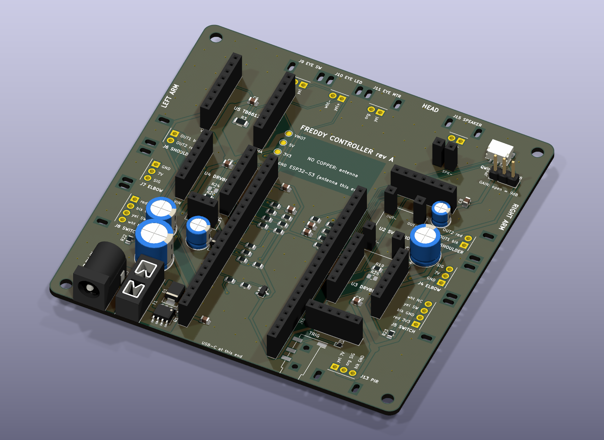
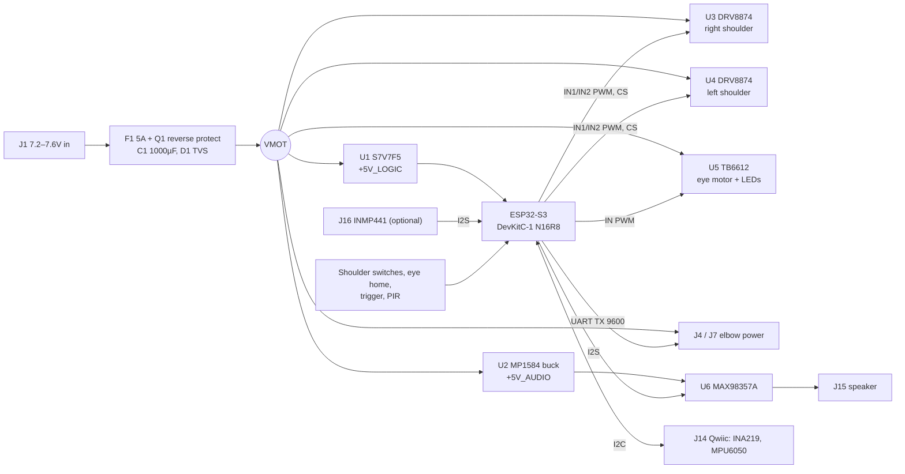
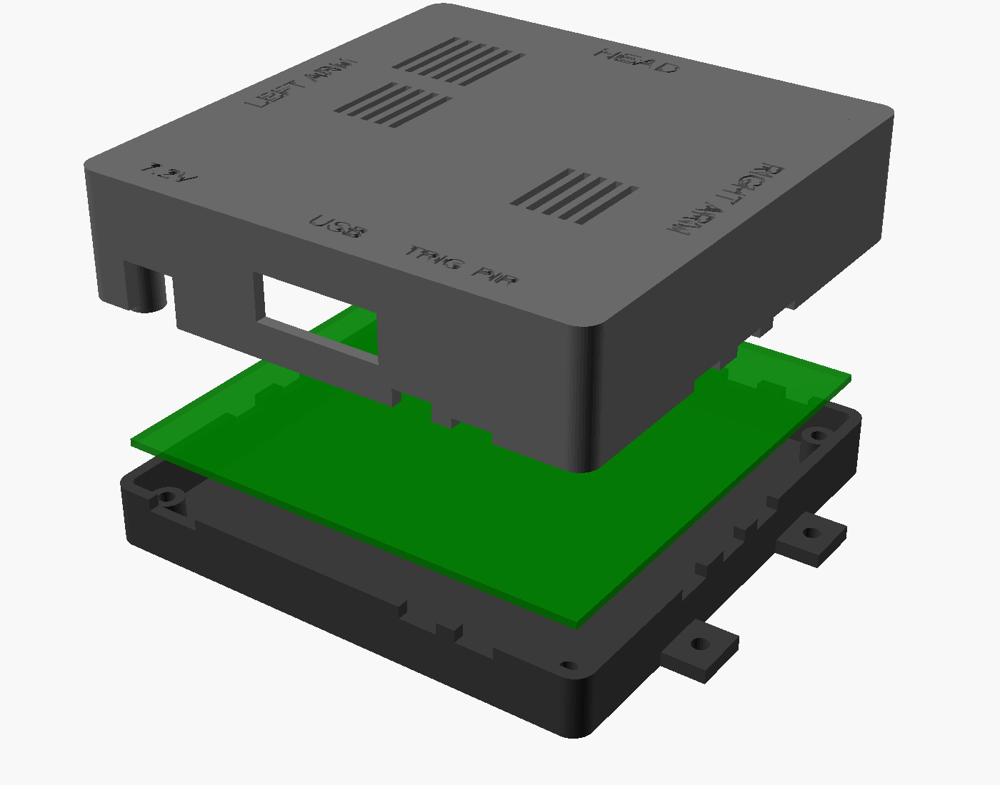

# Phase 2: controller PCB (rev A)

A carrier board that replaces the stock SD03-122. The ESP32-S3 and the power and driver parts are off-the-shelf modules on headers, so rev A is easy to hand-solder, debug and rework. A later revision can put the parts directly on the board once the design has proven itself.

**Status:** KiCad 9 project done: schematic, 100×100 mm two-layer layout, fully routed, DRC clean, with fab files for JLCPCB and a 3D-printable enclosure. Not ordered yet. Everything is generated from one file, [`tools/kicad/design.py`](../tools/kicad/design.py) (parts, nets, placement), so a change there flows into the schematic, the board and the enclosure. See [KiCad project](#kicad-project) below for how to open, regenerate and order it.



| What | File |
| --- | --- |
| KiCad project (open this) | [hardware/controller/kicad/freddy-controller.kicad_pro](../hardware/controller/kicad/) |
| Schematic | [controller_schematic.pdf](../schematics/controller_schematic.pdf) · [svg](../schematics/controller_schematic.svg) |
| 3D renders | [top](../hardware/controller/renders/pcb_top.png) · [bottom](../hardware/controller/renders/pcb_bottom.png) · [3D](../hardware/controller/renders/pcb_3d.png) · [STEP](../hardware/controller/renders/freddy-controller.step) |
| JLCPCB files | [gerbers zip](../hardware/controller/fab/freddy-controller-revA-gerbers.zip) · [BOM](../hardware/controller/fab/jlc_bom.csv) · [CPL](../hardware/controller/fab/jlc_cpl.csv) |
| Full BOM | [bom.csv](../hardware/controller/bom.csv) |
| Net list | [netlist.csv](../hardware/controller/netlist.csv) |
| Enclosure | [freddy_enclosure.scad](../hardware/controller/enclosure/freddy_enclosure.scad) · [base STL](../hardware/controller/enclosure/freddy_enclosure_base.stl) · [lid STL](../hardware/controller/enclosure/freddy_enclosure_lid.stl) |

### Modules (all measured or from the maker's drawing)

- **ESP32-S3-N16R8 dev board** (dual USB-C, YD-ESP32-S3 style, DevKitC-1 pinout): 2×22 pins, rows 1.0" (25.4 mm) apart, 63.6 × 28.1 mm including the antenna overhang. RGB LED on GPIO48.
- **Pololu DRV8874 carrier (#4035)** ×2: 0.6 × 0.7", 2×7 pins, rows 0.5" (Pololu dimension drawing). Top view: VIN, GND, OUT1, OUT2, IMODE, FLT, CS in one column; VM, GND, IN1, IN2, PMODE, SLP, VREF in the other. Power goes into **VIN** (reverse-protected onboard); VM stays unconnected. Onboard 2.49k on CS → 450µA/A × 2.49k = **1.12 V/A**; VREF is pulled up to SLP through 10k, so with SLP at 3.3V the limit is **≈2.9A** with no mods. The VIN/OUT column faces each arm's connectors. (The bench DRV8876 is a different red board; see the [power test](phase2-power-test.md).)
- **TB6612 breakout** (SparkFun layout): 2×8, rows 0.6". Logic column PWMA, AIN2, AIN1, STBY, BIN1, BIN2, PWMB, GND; power column VM, VCC, GND, AO1, AO2, BO2, BO1, GND.
- **MAX98357A breakout** (Adafruit-style): 1×7 (LRC, BCLK, DIN, GAIN, SD, GND, VIN), plus pins in the two speaker holes (3.5 mm apart, 13 mm from the row, centred on GAIN) that plug into single-pin sockets, so the PCB carries the speaker output to J15. SD open = (L+R)/2 mono.
- **MP1584 module**, fixed 5V: four corner pads on an 8.3 × 13.2 mm grid (not on the 0.1" grid): four single-pin sockets, or solder it flat.
- **Pololu S7V7F5** (3-pin reg09a): 1×3 (VIN, GND, VOUT), 12.4 × 8.9 mm, stands upright.

## Block diagram



## Design choices

- **Modules, not bare chips (rev A).** The driver and regulator modules already have their bypass caps, current-sense resistors and thermal copper. Each one sits on 0.1" headers, so a dead driver is a 30-second swap.
- **Three rails.** VMOT is the raw adapter after the fuse. It drives the shoulders, eye motor and elbows directly, as the stock board does. Logic and audio each get their **own regulator**, because a class-D amp on the ESP32's rail would put noise on WiFi and the ADC. Logic uses a **buck-boost** (Pololu S7V7F5) because the adapter sags to ~4.9V during a lift. Audio uses a plain **buck** (MP1584): the amp runs from 2.5 to 5.5V, so a sag only makes it a little quieter.
- **Power entry:** J1 barrel jack → F1 (mini blade fuse, 5A) → Q1, an AO4407A P-MOSFET (SOIC-8, ~15mΩ) as reverse-polarity protection: drain to the fuse, source to VMOT, gate to GND through R26. A reversed plug leaves it off. D1 (SMBJ8.5A) clamps spikes on VMOT, and C1 (1000µF) is the bulk reservoir. Small top-layer pours carry the input current between J1, F1 and Q1.
- **D2 Schottky into the ESP32's 5V pin**, so plugging in USB while the board is powered can't backfeed the regulator (and the other way around).
- **DRV8874 for the shoulders** (bench-tested with a DRV8876; the PCB uses the Pololu DRV8874 carrier). It runs down to 4.5V (the DRV8871 needs 6.5V, and the adapter sags to ~4.9V), has IN/IN control and an analog current output (IPROPI/CS), so the ESP32 can see a stall or a "the arm hit the stop" spike. That covers most of what the INA219 was for. The shoulder motor measured ~2Ω, so starting a lift takes 1.5–1.8A and a stall is 3.5A+: the DRV8876 (1.3A continuous) couldn't start the arm at its stock current limit. The DRV8874 (2.1A continuous, 6A peak) with the limit set around 2.5–3A has the headroom, and the firmware stops on stalls.
- **TB6612 for the head.** Channel A runs the eye motor (one direction, but the H-bridge gives braking). Channel B runs the LEDs (measured: one direction, yellow +, ~2.8V at ~20mA). R3 = 220Ω sets about the stock brightness at full on; PWM dims and flickers.
- **VREF left to the module.** Each DRV8874's VREF isn't tied to 3V3: the carrier's own 10k pull-up to SLP holds it at 3.3V (≈2.9A limit). R24/R25 (not fitted) sit from VREF to GND to lower the limit if needed (10k → 1.65V → ≈1.5A).
- **ADC filtering:** 100nF on CS_R, CS_L and VMON (C12–C14) with the 1k series resistors (and the divider) smooth the readings the bench showed were noisy.
- **Every external input** has a 1k series resistor and a pull resistor. The trigger jack (the only user-facing input) also gets a TVS. The PIR output only reaches ~1.3V on motion (measured), which is too low to read reliably as a digital input on a 3.3V ESP32. So GPIO9 reads it with the **ADC** (it's on ADC1) against a ~0.6V threshold, with a 100k pulldown so an unplugged sensor reads idle. The BAT54S clamp stays as protection.
- **Audio:** MAX98357A (I2S in, 3W class D out, no DAC needed). The INMP441 microphone shares BCLK/WS, so it's one full-duplex I2S bus and costs only one extra GPIO.

## GPIO map

| GPIO | Net | Use |
| --- | --- | --- |
| 1 | VMON | Supply voltage, 47k/22k divider (ADC1) |
| 2 | CS_R | Right shoulder current (ADC1) |
| 4 | CS_L | Left shoulder current (ADC1) |
| 5 | SW_SH_R | Right shoulder switch |
| 6 | SW_SH_L | Left shoulder switch |
| 7 | SW_EYE | Eye home switch (10k pull-up) |
| 8 | TRIG | Trigger jack (10k pull-up) |
| 9 | PIR | PIR output, read as analog (ADC1), ~1.3V = motion |
| 10 | I2S_DIN | Microphone data |
| 11, 12 | EYE_M1/2 | TB6612 channel A, eye motor |
| 13, 14 | SH_L_IN1/2 | Left shoulder DRV8874 (PWM) |
| 15, 16 | EYE_L1/2 | TB6612 channel B, eye LEDs |
| 17 | ELBOW_R_TX | UART1 TX, right elbow |
| 18 | ELBOW_L_TX | UART2 TX, left elbow |
| 21 | I2S_WS | I2S word select |
| 38, 39 | SH_R_IN1/2 | Right shoulder DRV8874 (PWM) |
| 40 | I2S_BCLK | I2S bit clock |
| 41, 42 | I2C_SDA/SCL | Qwiic header |
| 47 | I2S_DOUT | Amp data |
| 48 | — | Onboard RGB LED (status) |

**Changed during layout:** the eye pins moved to 11/12/15/16 (left header, next to the TB6612), the right shoulder to 38/39 and I2C to 41/42 (right header, next to the right driver and the Qwiic port). Every signal now leaves the ESP32 on the side it's going to, which is what let the board route cleanly. The bench sketches (`freddy_power_test`, `freddy_web`, `freddy_head_test`) still use the breadboard pins; the PCB firmware uses this table.

Avoided: strapping pins 0, 3, 45, 46; USB 19, 20; octal PSRAM 35–37; UART0 43, 44 (kept for the serial console). No clean GPIOs are left. GPIO 3, 45 and 46 can still drive outputs (with care at boot), and the Qwiic header is the main expansion port.

## Connectors

**Drop-in: Freddy's harness is not modified.** Each harness connection is a short **pre-made JST SM pigtail** (the inline 2.54 mm connectors Freddy already uses) soldered straight into plated pads on the board, and Freddy's original plugs mate with them. Pigtail gender is the opposite of Freddy's ends; pin counts match Freddy's plugs. Pads: 1.2 mm drill, 2.54 mm spacing (20–22 AWG), with a pair of zip-tie holes behind each group for strain relief. Silkscreen next to every pad group: the cable name and Freddy's wire colors. **Mix-ups:** Freddy's own plugs set the sizes, and the head cables and shoulder motors are all 2-pin, so the pigtails are grouped by body part (arm pigtails at each arm end, head pigtails together) and each gets a heat-shrink label. The one harmful swap is the eye LED plug onto a shoulder motor pigtail. Wire colors below are Freddy's, and pin 1 is listed first.

| Ref | Goes to | Pins |
| --- | --- | --- |
| J1 | Adapter | Through-hole 5.5×2.1mm barrel jack, center + (matches the current 7.2V adapter), rated 5A+. The J2 screw terminal was dropped in layout: there wasn't room beside the fuse, and a battery or bigger brick can use a barrel pigtail |
| J3 / J6 | Right / left shoulder motor (cable 1) | 1 OUT1, 2 OUT2 |
| J4 / J7 | Right / left elbow (cable 2) | 1 GND, 2 VMOT, 3 signal |
| J5 / J8 | Right / left shoulder switch (cable 3) | 1 +3V3 through 220Ω (R22/R23, red), 2 GND (black), 3 switch (yellow), 4 white (test point only) |
| J9 | Eye home switch (head cable 1) | 1 switch (yellow), 2 GND (white) |
| J10 | Eye LEDs (head cable 2) | 1 LED + (yellow), 2 LED − (white) |
| J11 | Eye motor (head cable 3) | 1 motor (yellow), 2 motor (orange) |
| J12 | Trigger | 3.5mm mono jack: tip = TRIG, sleeve = GND |
| J13 | PIR | 1 VMOT (yellow, power), 2 signal (orange), 3 GND (black). Powered from VMOT, as the stock board does |
| J14 | I2C | JST-SH 4-pin Qwiic on the top edge (handy for a sensor in the head): GND, 3V3, SDA, SCL |
| J15 | Speaker | 2 solder pads (1 +, 2 −), wired from the amp's speaker holes. Cut the speaker's JST-PH plug off and solder its wires straight in, extending them to reach the head. Zip-tie holes behind |
| J16 | INMP441 module (later) | 1×6 female header: 1 VDD (3V3), 2 GND, 3 L/R (GND), 4 WS, 5 SCK, 6 SD. Check against the module's pin order before plugging it in |
| JP1 | Amp gain | 3-pin jumper on the amp's GAIN pin: open = 9 dB (default), to GND = 12 dB, to VIN = 6 dB (15 dB would need 100k to GND) |

## Power budget

| Load | Rail | Typical | Peak |
| --- | --- | --- | --- |
| Shoulder motor, each | VMOT | ~1–2A once moving (estimate: a moving motor draws far less than a stalled one) | ~2.8A (current limit); 3.5A+ unlimited stall |
| Elbow module, each | VMOT | ~0.1A | ~0.5A moving (estimate) |
| Eye motor + LEDs | VMOT | ~0.1A (motor 80–90mA measured, LEDs ~20mA) | ~0.4A (motor start, estimate) |
| ESP32-S3 (WiFi on) | +5V_LOGIC | 0.15A | 0.5A bursts |
| Speaker amp, 3W into 4Ω | +5V_AUDIO | 0.3A | 0.8A |

**Bench results (breadboard, DRV8876, one arm):** a stalled or barely moving shoulder drew 2.1A at 40% and 2.6–2.7A at 70%, and the 7.2V adapter sagged to ~5.0V at 2.7A (about 0.8Ω of source resistance in the adapter and wiring). The arm was weak because the DRV8876 (~0.7Ω) and the breadboard ate about half the voltage; the DRV8874 (~0.2Ω) and real copper fix that.

The stock board lifts both arms at once on the same 4A adapter because its gentle ~3V drive actually reaches the motors, and **moving** motors draw much less than stalled ones. So two arms together should fit the existing adapter once our drive is efficient. The motor copper is sized for **~6A** anyway, so a **7.5V 6A adapter** works as an upgrade (with a barrel jack rated for it). Firmware: don't start both shoulders at full drive at the same instant, and stop on stall (CS readings).

**Fuse:** F1 is a through-hole **mini** blade fuse holder (Keystone 3568). The full-size ATC holder didn't fit beside the barrel jack, so this takes mini blade fuses, not the ATC ones from the Phase 1 breakout. Use 5A with the 4A adapter, 7.5A with a 6A adapter.

## Layout

- 100×100 mm (JLCPCB's cheapest size), 2 layers, 1 oz copper, M3 holes in the corners, rounded corners.
- Cables leave toward the body part they serve. Viewed from the component side with the head end up: head pigtails (J9–J11), the speaker pads (J15) and the Qwiic port on the top edge; left arm (J6–J8) on the left edge; right arm (J3–J5) on the right edge; power (J1, F1), the trigger jack, the PIR pads and the ESP32's USB-C on the bottom edge. Mirror left and right if the board ends up mounted facing the other way.
- Each arm's DRV8874 sits next to its arm's pads with its VIN/OUT column facing them; the TB6612 sits under the head pads; the amp and MP1584 sit top-right.
- The ESP32 runs vertically down the middle, antenna up, USB-C at the bottom edge. A 24×14 mm keep-out (no copper on either layer) sits under the antenna. Most input resistors and filter caps sit **under the ESP32**, between its header rows, next to the pins they serve (JLC solders them; the ESP32 plugs in on top). Their designators are listed on the back silkscreen.
- Routed with Freerouting, then the power tracks were widened wherever there was room: VMOT, the input and the shoulder outputs at 1.0–2.0 mm, the 5V/3V3/GND tracks at 0.5–0.8 mm. GND pours on both layers, stitched with vias, plus small VMOT/input pours around the fuse and Q1. If the arms ever look power-starved, order 2 oz copper: same files, about $10 more.
- Silkscreen: each pad group is labeled with the cable name and Freddy's wire colors; module outlines show which way each module plugs in (pin 1 squares, "VIN", "VM", "PWMA" marks).
- DRC is clean (0 errors, 0 unconnected) and the board matches the schematic (0 parity issues). The remaining warnings are cosmetic silkscreen overlaps.

## Open questions

1. **Cable 3 white wire.** Still unknown. It goes to a test point only, so nothing depends on it.
2. **Elbow current.** Not measured yet. Add an INA219 on J14 during bring-up to log it.

## KiCad project

Open `hardware/controller/kicad/freddy-controller.kicad_pro` in KiCad 9 (Arch: `sudo pacman -S kicad kicad-library kicad-library-3d`). The project carries its own symbol and footprint libraries (`freddy.kicad_sym`, `freddy.pretty`) for the modules and pigtail pads.

Regenerating needs KiCad 9 (its Python module), Java 21+ and the [Freerouting 2.1 jar](https://github.com/freerouting/freerouting/releases). Freerouting is randomised, so `route.py` tries up to eight times and keeps the first fully connected result; each run gives a slightly different (equally valid) layout.

**Don't hand-edit the generated files** if you want to keep regenerating: change [`tools/kicad/design.py`](../tools/kicad/design.py) and rebuild. Hand edits in KiCad are fine too, but the next regeneration overwrites them.

```bash
cd tools/kicad
python3 gen_footprints.py      # custom footprints
python3 gen_schematic.py       # schematic + symbol library
python3 gen_pcb.py             # placed, unrouted board
python3 route.py ~/freerouting-2.1.0.jar   # autoroute, widen power tracks, pours, stitching
python3 gen_fab.py             # gerbers, JLC BOM/CPL, CSVs, schematic PDF, renders, STEP
python3 gen_enclosure.py       # OpenSCAD enclosure + STLs
```

### Ordering from JLCPCB

1. Upload `fab/freddy-controller-revA-gerbers.zip`. Defaults are fine: 2 layers, 1.6 mm, HASL, any colour. 5 boards.
2. Turn on **PCB Assembly** (top side, Economic). Upload `fab/jlc_bom.csv` and `fab/jlc_cpl.csv`. The BOM has values and part numbers but no LCSC numbers, so JLC's matcher will ask you to confirm each line: pick the basic-part 0805 resistors and capacitors it suggests, and search the MPN for the rest (SS34, SMBJ8.5A, AO4407A, BAT54S, ESD5Z3V3, PJ-320D, SM04B-SRSS-TB). Check the rotation preview, especially Q1, D1–D4 and J14.
3. Everything through-hole is yours to solder: the module sockets, J1, F1, the electrolytics, JP1, J16, and the pigtails.

## Enclosure



A two-part printed box: a base with standoffs for the PCB, and a lid with a locating lip, vents over the drivers and the TB6612, and raised labels (HEAD, LEFT ARM, RIGHT ARM, 7.2V, USB, TRIG, PIR). Every cable exits through a notch on the matching side; the notches are open at the top so the board drops in with the pigtails already soldered, and tabs on the lid close them down to a 7 mm cable window (taller for the barrel jack and USB-C). Mounting ears on the sides take screws into Freddy's base.

- About 106 × 106 × 36 mm outside (base, plus the mounting ears) and a 2 mm lid. Inside clearance above the PCB is 26 mm: the tallest parts are the upright S7V7F5 (~23.5 mm on its socket) and C1 (use a 10×16 or 10×20 mm can).
- PCB on 6 mm standoffs, held with four M3×8 self-tapping screws.
- `freddy_enclosure.scad` is parametric: wall thickness, clearances, notch positions and vents are named lists at the top. Render a part with `openscad -D 'part="base"' -o base.stl freddy_enclosure.scad`.
- Print the first one at home in PETG to check fit; order the final from JLC3DP in nylon (MJF PA12) if you want it tough.

## Next steps

1. When the DRV8874s arrive: CS to GND ≈ 2.49k on each.
2. Open the project in KiCad and look it over (View → 3D Viewer). Anything you want moved goes into `design.py`.
3. Order 5 boards with assembly (JLCPCB), plus the hand-solder parts in the BOM.
4. Print the enclosure at home and check the fit against the bare PCB.
5. Bring-up order: power only (no modules) → regulators → ESP32 → one subsystem at a time, with a PCB pin-map version of the Phase 1 test sketches.
