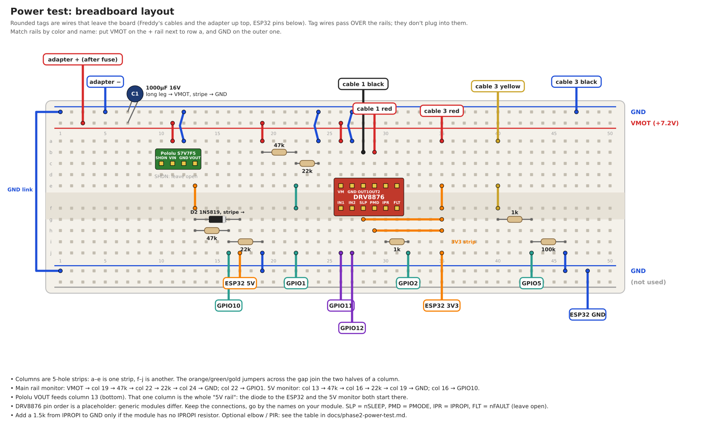
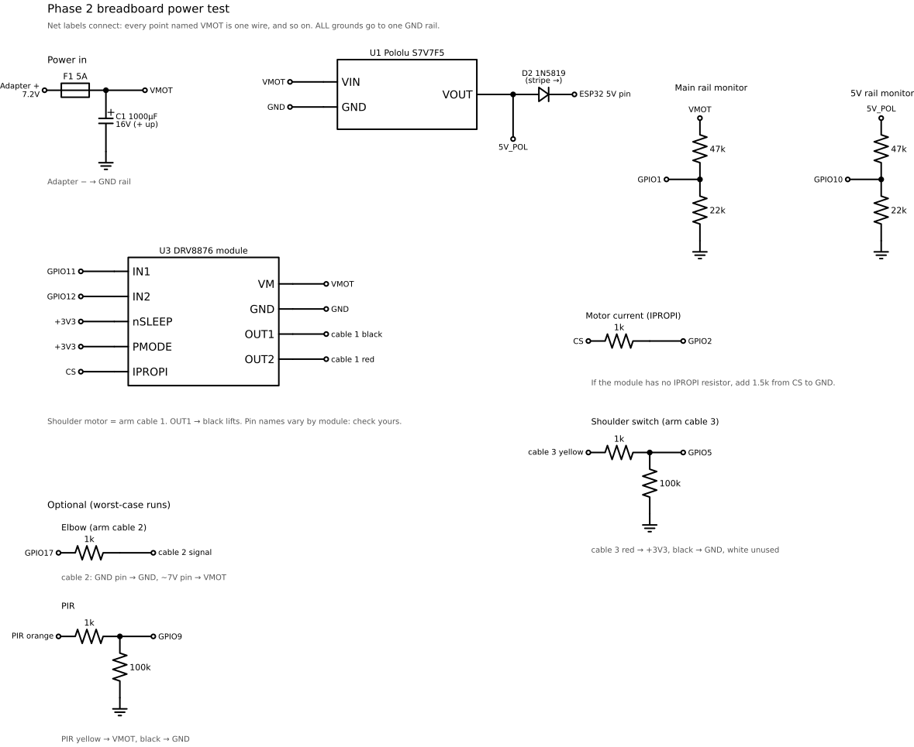

# Phase 2: breadboard power test

**The question:** does the ESP32's 5V stay up when a shoulder lift drags the 7.2V adapter down to about 4.9V? This is the last real risk in the [controller design](phase2-pcb.md), so it gets proven on a breadboard before the board is ordered.

**Pass:** the Pololu 5V output stays above **4.75V** through every lift, and the ESP32 never resets.

## Parts

- Freddy's 7.2V 4A adapter, the Phase 1 power breakout (5A fuse), one arm (cable 1 and cable 3)
- ESP32-S3 dev board
- Pololu S7V7F5 (5V buck-boost) and one DRV8876 module
- 1000µF 16V capacitor, 1N5819 Schottky diode (or 1N5817; not a 1N400x, which drops too much voltage). The PCB uses the surface-mount SS34 instead
- Resistors: 47k ×2, 22k ×2, 1k ×2, 100k ×1 (plus 1.5k if the DRV8876 module has no IPROPI resistor)
- Optional, for the worst-case run: an elbow (cable 2) and the PIR, plus 1k ×2 and 100k ×1

**Stock board fully disconnected** from the arm during this test.

## Wiring

Hole-by-hole breadboard layout (start here):



The same circuit as a schematic:



There's no separate 5V rail: the Pololu's output lands on one column (13, bottom half), and the diode to the ESP32 and the 5V monitor both start from it.

| From | To | Notes |
| --- | --- | --- |
| Adapter + (after the 5A fuse) | **VMOT** rail | The breadboard's + rail. Check that the rail isn't split in the middle |
| Adapter − | **GND** rail | Every ground in this table goes here, including the ESP32's GND pin |
| 1000µF + / − | VMOT / GND | Close to the DRV8876. Stripe = negative |
| Pololu VIN / GND | VMOT / GND | |
| Pololu VOUT → 1N5819 → ESP32 **5V** pin | | Diode stripe toward the ESP32. Stops USB and the Pololu from fighting |
| DRV8876 VM / GND | VMOT / GND | |
| DRV8876 OUT1 / OUT2 | cable 1 **black** / **red** | IN1 drives OUT1 high = lift |
| DRV8876 IN1 / IN2 | GPIO11 / GPIO12 | |
| DRV8876 nSLEEP, PMODE | 3V3 | PMODE high = PWM (IN/IN) mode. Names vary by module |
| DRV8876 IPROPI → 1k → GPIO2 | | Current sense. Add 1.5k IPROPI→GND if the module lacks one |
| VMOT → 47k → **GPIO1** → 22k → GND | | Main rail monitor |
| Pololu VOUT → 47k → **GPIO10** → 22k → GND | | 5V rail monitor (before the diode) |
| Cable 3 red / black | 3V3 / GND | Shoulder switch power |
| Cable 3 yellow → 1k → **GPIO5**, 100k GPIO5→GND | | Shoulder switch. White unused |
| *Optional:* GPIO17 → 1k → cable 2 signal; cable 2 GND / ~7V pins → GND / VMOT | | Elbow |
| *Optional:* PIR orange → 1k → **GPIO9**, 100k GPIO9→GND; yellow → VMOT, black → GND | | PIR |

## Before powering the motor

1. **Pololu alone:** adapter on, nothing else connected to VOUT. Meter on VOUT: 4.9–5.1V.
2. **Dividers:** GPIO1's node should read ~2.3V (7.2V × 0.319), GPIO10's ~1.6V.
3. **Then** connect the ESP32 and the DRV8876, and flash [`firmware/freddy_power_test`](../firmware/freddy_power_test/).

The sketch starts cycling **5 seconds after boot** (the RGB LED blinks blue during the countdown). Any key in the serial monitor cancels it, and `x` or space stops the motor at any time.

## Pass 1: measure (USB connected)

With USB plugged in, the ESP32 runs off USB, so this pass can't catch a reset. But the 5V monitor reads the Pololu's output directly, so the numbers are real.

```bash
picocom -b 115200 --imap lfcrlf /dev/ttyACM0
```

Each lift and lower ends with a summary line:

```
# cycle 3: VMOT min 4.92V | 5V min 4.98V | peak 1.12A ok
```

Run 10 cycles at the default stock-like lift (50% duty), then press `]` to step the lift up to 100% for 5 more. Full drive is harsher than the stock show, so it's the worst case. To save the CSV log, run `picocom ... | tee power_run1.csv`.

`s` prints totals at any time. `v` toggles the 100 Hz log if it's too noisy.

## Pass 2: no USB (the real test)

1. Press `c` to clear the reset counters, then `x`.
2. Unplug USB. Power-cycle the adapter.
3. The LED blinks **red once** (one boot since clearing), then cycling starts on its own. Let it run 5 minutes.
4. Power-cycle the adapter again and count the red blinks: **two = pass** (the boot from step 2 plus this one). More red blinks mean the ESP32 reset during the run. Yellow blinks after the red ones count brownout resets specifically.
5. Plug USB back in and press `s` for the exact counts.

## Optional: worst case

If pass 2 is clean, stack everything at once: lift duty 100%, `e` to add elbow moves (right elbow −700 ↔ 0 in time with the shoulder), and briefly hold the arm mid-lift to make it stall. Watch the summary lines. If 5V still stays above 4.75V, the power design is proven.

## If it fails

- **5V dips but no reset:** add a second 1000µF on VMOT, or a 470µF right at the Pololu's input.
- **Resets:** check that grounds are tied at one point (adapter −) and the main feed is 22AWG or heavier. If it still resets, it's time for the 7.5V 6A adapter.
- **Lift timeout message:** the switch never went high. Check cable 3, or that OUT1 really is on black. If the arm went *down* first, swap OUT1 and OUT2.
- **Peak current reads 0:** IPROPI isn't wired or has no resistor to ground. Fix the CS_MV_PER_A constant in the sketch once the module is known.

Record the results here (min VMOT, min 5V, peak current, resets) when the test is done.
